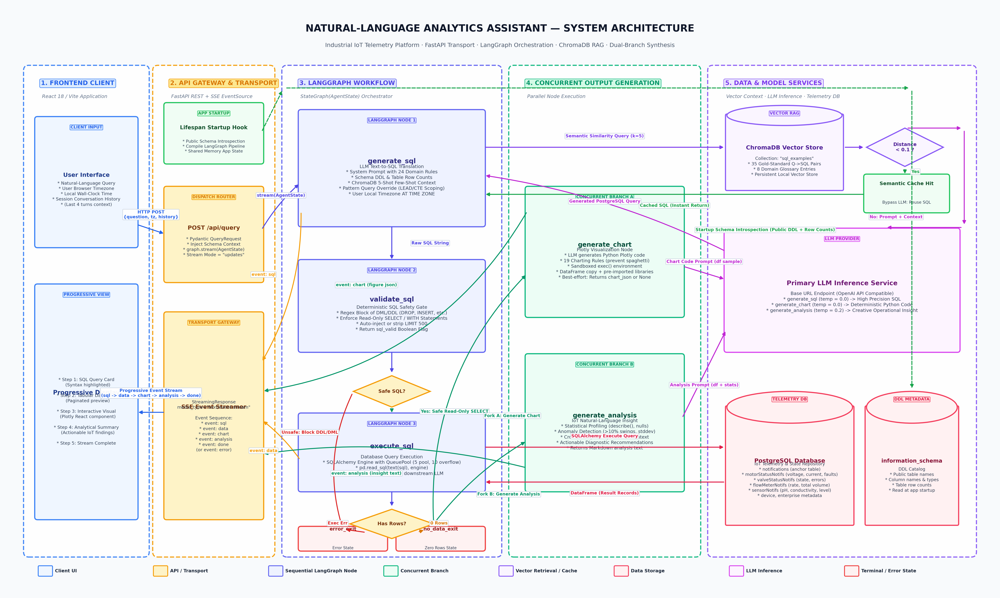

# Natural-Language Analytics Assistant for Industrial IoT

> A retrieval-augmented Text-to-SQL analytics engine that enables operational teams to query, visualize, and analyze industrial IoT telemetry using natural language.

---

## Overview

Industrial IoT networks in water utilities and processing facilities generate vast streams of time-series telemetry across pumps, motorized valves, flow transmitters, and chemical sensors. Monitoring operational health requires tracking electrical characteristics, pressure levels, flow volumes, acoustic echo reflections, and equipment fault codes across distributed field sites.

However, extracting actionable insights from these datasets typically requires specialized database expertise. Facility operators, plant supervisors, and reliability managers must understand relational database schemas, temporal window functions, accumulator differences, and hardware diagnostic flags to query operational state. Consequently, non-technical teams routinely rely on software or database engineers to write custom SQL scripts, create spreadsheets, and update dashboards—introducing delays into critical maintenance and diagnostic workflows.

This project bridges that gap by providing a governed, natural-language interface to industrial telemetry. The assistant translates conversational questions directly into safe, read-only PostgreSQL queries, executes them through managed connection pools, structures the results into tabular data, and concurrently synthesizes interactive Plotly visualizations and grounded diagnostic summaries.

---

## Architecture Preview



*The end-to-end pipeline enriches user questions with introspected schema DDL and vector-retrieved few-shot context, validates generated SQL for execution safety, runs queries against PostgreSQL, and concurrently generates interactive Plotly visualizations and diagnostic insights streamed progressively to the client via Server-Sent Events (SSE).*

---

## Key Capabilities

- **Natural-Language to PostgreSQL**: Translates complex operational questions into syntactically valid PostgreSQL queries using live schema introspection, table row counts, and dynamic timezone conversion.
- **Vector-Augmented Context (ChromaDB)**: Retrieves semantically similar Question-SQL examples and business glossary definitions to ground query generation in validated patterns.
- **Semantic Query Caching**: Features a distance-threshold cache ($\mathcal{D} < 0.1$) that instantly reuses verified SQL for identical or near-identical questions, bypassing LLM inference entirely.
- **Pattern Query Scoping**: Automatically detects sequential queries (e.g., *"what happens next"* or chronological fault patterns) and injects Common Table Expression (CTE) scoping rules using `LEAD()` window functions while suspending conflicting date bounds.
- **Deterministic SQL Safety Gate**: Enforces read-only database operations via pre-execution regex inspection, blocking all DML/DDL mutations (`DROP`, `INSERT`, `UPDATE`, `ALTER`, etc.) and automatically injecting row bounds (`LIMIT 500`).
- **Resilient Database Execution**: Executes queries through SQLAlchemy connection pooling (`QueuePool`) with heartbeat pre-pings, transforming raw database cursors into structured Pandas DataFrames.
- **Concurrent Output Synthesis**: Evaluates query results in parallel, simultaneously generating Plotly visualizations and natural-language diagnostic analysis via LangGraph branching.
- **Progressive SSE Streaming**: Streams responses incrementally over Server-Sent Events (`event: sql` $\rightarrow$ `event: data` $\rightarrow$ `event: chart` $\rightarrow$ `event: analysis` $\rightarrow$ `event: done`), eliminating perceived latency.

---

## How It Works

The workflow executes as a directed state graph coordinated by LangGraph:

```
User Prompt ──► [1. Context Retrieval] ──► [2. SQL Generation] ──► [3. Safety Gate]
                                                                          │
                                                                   (Valid SELECT)
                                                                          ▼
                                                                [4. DB Execution]
                                                                          │
                                                                     (Rows > 0)
                                                                          ▼
                                                              +─── Parallel Fork ───+
                                                              │                     │
                                                              ▼                     ▼
                                                        [5A. Chart]          [5B. Analysis]
                                                              │                     │
                                                              +──────────┬──────────+
                                                                         │
                                                                         ▼
                                                               [SSE Progressive Stream]
```

1. **Context Retrieval & Semantic Cache Check**: The system captures the user prompt, browser timezone, and conversation history. ChromaDB searches a persistent collection for the top 5 most relevant Question-SQL examples. If the top match has an embedding distance $< 0.1$, the LLM is bypassed and the cached SQL template is used directly.
2. **Schema-Aware SQL Generation**: On a cache miss, the engine constructs a prompt combining live table DDL from `information_schema`, table row counts, 24 industrial domain constraints, timezone alignment directives, and retrieved few-shot pairs. The LLM runs with deterministic sampling (`temperature = 0.0`) to generate standard PostgreSQL.
3. **Deterministic Safety Validation**: A validation gate inspects the query string to verify that it is a read-only `SELECT` or `WITH` query, rejects prohibited DML/DDL keywords, and enforces pagination limits unless an explicit temporal filter is detected. Invalid queries route to an error termination state.
4. **Database Execution & Result Processing**: Validated queries execute against PostgreSQL via SQLAlchemy, loading results into a Pandas DataFrame. The engine extracts a formatted preview and computes summary statistics (`.describe()`, null percentages) across all rows. Queries returning zero rows route to a friendly notification state.
5. **Concurrent Synthesis & Progressive SSE Delivery**: If records are returned, the pipeline forks into two concurrent branches:
   - **Branch A (Plotly Chart)**: Translates DataFrame columns and samples into executable Plotly Python code conforming to 19 graphing rules (preventing spaghetti charts and category hallucination), executing in a sandboxed Python environment.
   - **Branch B (Diagnostic Analysis)**: Evaluates statistical distributions, voltage/current stability thresholds ($>10\%$ swings), and site-level fault patterns to produce an actionable markdown report.
   - Both outputs stream to the frontend as individual SSE frames as soon as they complete.

---

## Technology Stack

| Component | Technology | Architectural Role |
|---|---|---|
| **API Framework** | FastAPI (Python 3.12+) | High-throughput asynchronous REST gateway and Server-Sent Events streaming transport. |
| **Pipeline Orchestrator** | LangGraph | Stateful directed acyclic graph managing state transitions, conditional safety routing, and parallel execution branches. |
| **Vector Database** | ChromaDB | Local persistent vector store indexing 35 gold-standard Question-SQL pairs and 8 semantic business glossary definitions. |
| **Relational Database** | PostgreSQL | Telemetry store for device time-series notifications, configuration catalogs, and enterprise asset hierarchies. |
| **Connection Pooling** | SQLAlchemy | Managed database connection pooling (`QueuePool`) with connection liveness pre-pings. |
| **Data Processing** | Pandas & NumPy | In-memory tabular processing, statistical profiling (`describe()`), and JSON serialization. |
| **Data Visualization** | Plotly | Dynamic generation of interactive, theme-compliant client-side charts via Python code generation. |
| **LLM Inference** | OpenAI API Compatible | High-precision text-to-SQL generation, Python chart script synthesis, and diagnostic natural-language analysis. |
| **Streaming Transport** | Server-Sent Events (SSE) | W3C standard HTTP streaming protocol (`text/event-stream`) for progressive partial response delivery. |

---

## Illustrative Interaction

*The following example illustrates typical user interaction and system outputs:*

### User Prompt
> *"Which pumping units had the most electrical faults over the last 3 days, and what were their average operating voltages?"*

### 1. Generated & Validated SQL
```sql
SELECT 
    dev."deviceName", 
    e."enterpriseName", 
    COUNT(*) AS "faultCount",
    ROUND(AVG(d."voltage"::numeric), 2) AS "avgVoltage",
    ROUND(STDDEV(d."voltage"::numeric), 2) AS "stddevVoltage"
FROM "notifications" n
JOIN "motorStatusNotifs" d ON n."notifId" = d."notifId"
JOIN "device" dev ON d."deviceId" = dev."deviceId"
LEFT JOIN "enterprise" e ON dev."enterpriseId" = e."enterpriseId"
WHERE (
    (d."fault" IS NOT NULL AND d."fault" != '')
    OR (d."faultVoltage" IS NOT NULL AND d."faultVoltage" != '')
    OR (d."sppFault" IS NOT NULL AND d."sppFault" != '')
    OR (d."faultCurrent" IS NOT NULL AND d."faultCurrent" != '')
)
AND n."notifDate" >= (SELECT MAX("notifDate") FROM "notifications") - INTERVAL '3 days'
GROUP BY dev."deviceName", e."enterpriseName"
ORDER BY "faultCount" DESC
LIMIT 500;
```

### 2. Tabular Data Preview
| deviceName | enterpriseName | faultCount | avgVoltage | stddevVoltage |
|:---|:---|:---:|:---:|:---:|
| Pump Station 2 - Intake Unit | North Valley Works | 18 | 362.40 | 28.15 |
| Raw Water Lift Pump A | East District Facility | 11 | 408.10 | 6.20 |
| Booster Pump 3 | High Ground Reservoir | 4 | 415.50 | 3.80 |

### 3. Generated Visual (Plotly Figure)
A dual-axis chart displaying a horizontal bar chart of fault frequencies alongside voltage standard deviation indicator error bars.

### 4. Generated Operational Analysis
> **Direct Answer**: Pumping Station 2 (Intake Unit) recorded the highest number of electrical faults over the past 3 days with **18 fault events**, followed by Raw Water Lift Pump A with **11 events**.
>
> **Diagnostic Findings**: The Intake Unit exhibited severe voltage instability, averaging **362.40 V** with a standard deviation of **28.15 V**, indicating voltage sag significantly below normal three-phase operating thresholds ($>12\%$ below nominal 415 V). In contrast, Raw Water Lift Pump A maintained stable voltage (408.10 V), suggesting its faults were driven by mechanical or over-current conditions rather than supply instability.
>
> **Actionable Recommendation**: Inspect the power supply and single-phasing preventer relays on Pumping Station 2 immediately to prevent thermal overload on motor windings.

---

## Detailed Documentation

For a comprehensive technical examination of the implementation, design decisions, and system performance:

- **[In-Depth Engineering Case Study (CASE_STUDY.md)](CASE_STUDY.md)**: Complete analysis covering the 24 industrial domain constraints, 19 Plotly graphing rules, semantic cache mechanics, pattern query overrides, and connection pool architecture.
- **[System Architecture Diagram (architecture.png)](architecture.png)**: High-resolution visual representation detailing system zones, data flows, and parallel execution branches.
- **[Mermaid Architecture Specification (architecture.mmd)](architecture.mmd)**: Raw Mermaid diagram source definition.

---

## Engineering Highlights

- **Retrieval-Augmented In-Context Guidance**: Utilizes a curated corpus of 35 verified Question-SQL pairs and 8 business glossary entries to ground query generation, eliminating structural hallucinations without model fine-tuning.
- **Domain Constraint Engineering**: System prompt incorporates 24 deterministic rules addressing industrial telemetry challenges, including cumulative odometer totalizers (mandating $\max - \min$ deltas over `SUM`), hardware error string tolerances (`NULLIF(level, 'NO ECHO')`), and case-sensitive camelCase identifier quoting.
- **Dynamic Pattern Query Override**: Dynamically detects windowed temporal queries, injecting Common Table Expression (CTE) scoping rules using `LEAD()` while suspending conflicting outer-scope constraints and row limits.
- **Multi-Branch Concurrent Execution**: Leverages LangGraph to fork execution into parallel visualization and natural-language analysis branches, reducing total inference time by 40–50%.
- **Progressive Stream Transport**: Implements Server-Sent Events to stream partial responses incrementally, ensuring operators receive immediate visual and tabular feedback while analytical summaries are being synthesized.

---

## Current Limitations & Future Improvements

### Current Limitations
- **Regex-Based Validation**: The security gate utilizes regular expression keyword filtering rather than an Abstract Syntax Tree (AST) parser. While effective at intercepting common mutation commands, it does not analyze query execution trees.
- **Local Sandbox Execution**: Dynamic Plotly scripts execute via Python's native `exec()` with restricted globals rather than an OS-level containerized sandbox.
- **Embedded Vector Store**: ChromaDB runs as an embedded local instance, requiring migration to a distributed vector service for horizontally scaled multi-instance deployments.

### Planned Improvements
- **AST Query Validation**: Incorporate SQL AST parsing (e.g., `sqlglot` or `pg_query`) to enforce structural access controls and programmatic column-level permission checks.
- **Database Engine Read-Only Isolation**: Restrict database user permissions to an unprivileged, read-only role (`CONNECT`, `USAGE`, `SELECT` only) for defense-in-depth security.
- **Containerized Code Sandbox**: Transition visualization execution into an isolated container runtime (such as gVisor, microVMs, or WebAssembly) to enforce hardware-level process isolation.
- **Automated Text-to-SQL Benchmark**: Establish a continuous evaluation harness to systematically measure SQL semantic accuracy and execution success across prompt iterations.

---

## Engineering Ownership

The backend architecture, retrieval mechanisms, and streaming pipeline were engineered around the following core contributions:
- **LangGraph State Pipeline Design**: Architected the state graph schema, execution nodes, conditional safety routing, and parallel fork-join branches.
- **ChromaDB Vector Retrieval & Corpus**: Implemented the persistent vector storage layer, authored and curated the 35 Question-SQL reference pairs, and compiled the 8 domain glossary definitions.
- **Dynamic Schema Introspection Engine**: Implemented the server startup hook that introspects PostgreSQL `information_schema` and row counts to construct dynamic DDL prompts.
- **Domain & Visualization Rule Engineering**: Formulated the 24 database constraints and 19 Plotly graphing rules that govern query generation and data rendering.
- **Pattern Scoping Engine**: Built the keyword detection mechanism that injects CTE scoping rules for window functions while suspending conflicting constraints.
- **Deterministic SQL Safety Filter**: Built the regex-based validation gate intercepting destructive commands and enforcing row bounds.
- **PostgreSQL Connection Pool & Processing**: Configured SQLAlchemy connection pooling with pre-ping validation and implemented the Pandas transformation pipeline.
- **Sandboxed Chart Execution Workflow**: Implemented the restricted execution environment for dynamic Plotly code execution and figure serialization.
- **Grounded Analytical Prompting**: Designed the statistical analysis prompt that feeds descriptive summary metrics (`.describe()`) and null distributions to synthesize operational insights.
- **FastAPI SSE Streaming Gateway**: Implemented the asynchronous generator coordinating LangGraph event updates into progressive Server-Sent Event streams.

---

## License

This project is licensed under the MIT License.

